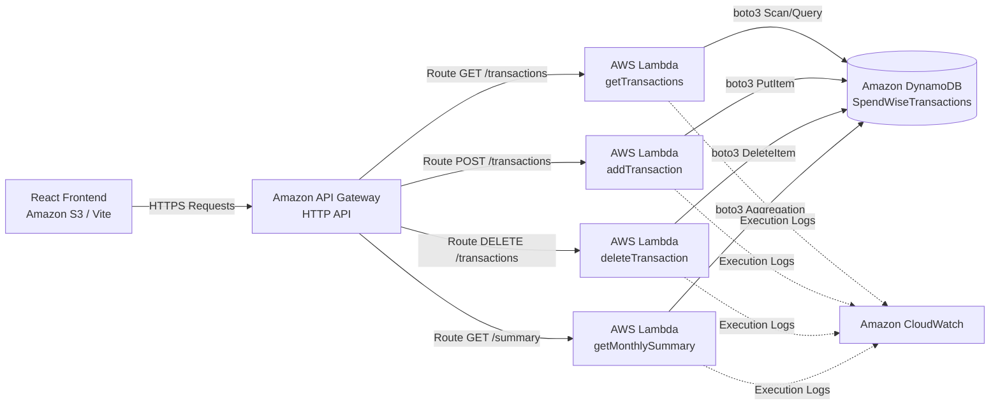

# SpendWise — AWS Serverless Backend Architecture

This directory provides the backend infrastructure code for **SpendWise – Smart Expense Tracker**, built on **AWS Serverless / Function-as-a-Service (FaaS)**.

## Architecture Overview



## AWS Services Utilized

1. **AWS Lambda (Python 3.12 Runtime)**
   - Micro-functions triggered on-demand per HTTP request.
   - Zero idle server costs, sub-second auto-scaling.
   - Handlers:
     - `lambda_handlers.get_transactions_handler`
     - `lambda_handlers.add_transaction_handler`
     - `lambda_handlers.delete_transaction_handler`
     - `lambda_handlers.get_monthly_summary_handler`

2. **Amazon API Gateway (HTTP API)**
   - Low-latency entrypoint with native CORS handling enabled.
   - Payload format 2.0.

3. **Amazon DynamoDB**
   - NoSQL serverless key-value database.
   - Table: `SpendWiseTransactions` (Partition Key: `id: String`).
   - On-Demand capacity mode (`PAY_PER_REQUEST`).

4. **Amazon CloudWatch**
   - Telemetry, logging of error stack traces, and request latency monitoring.

5. **Amazon S3 & CloudFront (Frontend Hosting)**
   - Static asset distribution for Vite production build (`dist/`).

---

## Deployment Instructions

### Method 1: Using AWS SAM CLI (Recommended)

1. Ensure AWS CLI and AWS SAM CLI are installed:
   ```bash
   sam --version
   aws sts get-caller-identity
   ```

2. Build the serverless application:
   ```bash
   cd aws-serverless
   sam build
   ```

3. Deploy to your AWS account:
   ```bash
   sam deploy --guided
   ```
   Follow the prompts to specify Stack Name (e.g., `spendwise-backend`) and AWS Region (e.g., `ap-south-1`).

4. Copy the resulting `HttpApiUrl` from the outputs.

5. In the frontend root:
   - Edit `.env`:
     ```env
     VITE_API_BASE_URL=https://<your-api-id>.execute-api.ap-south-1.amazonaws.com
     VITE_USE_MOCK_API=false
     ```
   - Or paste the URL directly in the **Settings** page within the running SpendWise web application!

---

## Connecting Frontend to AWS

The frontend is built with an abstraction layer:
- `src/config.js`: Central configuration holding `apiBaseUrl` and `useMockApi` flag.
- `src/services/api.js`: Universal fetch client for API Gateway.
- `src/services/transactionService.js`: Business service delegating between DynamoDB via Lambda and local mock storage.

